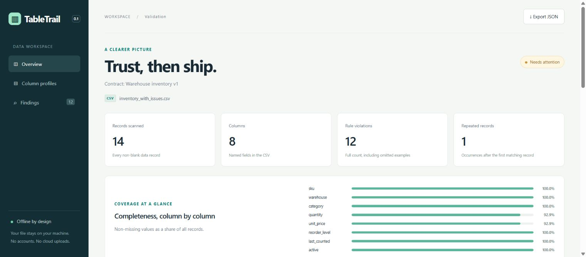

# TableTrail

**Catch broken CSV data before it becomes a broken workflow.**

TableTrail is a local-first Python toolkit for profiling CSV files, enforcing data contracts, and comparing dataset versions. It produces machine-readable JSON and an interactive, self-contained HTML report that opens offline.

**Python 3.11+ · No runtime dependencies · MIT licensed · CLI + Python API**



## Why this exists

A CSV can look fine in a spreadsheet while hiding duplicate keys, invalid dates, missing quantities, or a suddenly different schema. TableTrail makes those checks explicit and repeatable: describe the expected shape in a small JSON contract, run it locally, and inspect the exact records that need attention.

The included demo uses entirely **synthetic warehouse inventory**, with a clean version, a deliberately broken version, and a changed delivery. No real customer, employee, or other personal data is included.

## Quick start

```bash
git clone https://github.com/praneetpanwar444-gif/tabletrail.git
cd tabletrail
python -m venv .venv
```

Activate the environment:

```powershell
# Windows PowerShell
.venv\Scripts\Activate.ps1
```

```bash
# macOS / Linux / WSL2
source .venv/bin/activate
```

Then install from the checkout:

```bash
python -m pip install .
tabletrail profile examples/inventory.csv --json reports/profile.json --html reports/profile.html
```

Open `reports/profile.html` in your browser. There is no server to run and no account or API key to configure. You can also open the pre-generated `examples/validation-report.html` immediately after downloading the repository.

Without installation, run every command as `python -m tabletrail` from the repository root.

## A 3-minute demo

```bash
# 1. Healthy data passes (exit code 0).
tabletrail validate examples/inventory.csv --contract examples/inventory.contract.json

# 2. Deliberately broken data: 12 violations across 11 records (exit code 1).
tabletrail validate examples/inventory_with_issues.csv --contract examples/inventory.contract.json --json reports/validation.json --html reports/validation.html

# 3. A new delivery: four changes, including a new column and shifted prices.
tabletrail compare examples/inventory.csv examples/inventory_next.csv --html reports/comparison.html

# 4. Bootstrap a contract for a new file, then review the generated rules.
tabletrail init examples/inventory.csv --output reports/draft.contract.json
```

Exit code `1` in the second and third commands means findings were detected; it is expected for these fixtures. Code `2` means a malformed input, invalid contract, usage error, or file-system problem. A profile reports observations without enforcing rules, so duplicate records by themselves do not make a profile fail.

## What works today

| Capability | Behavior |
| --- | --- |
| Streaming profiling | Record counts, exact distinct counts, missing fractions, inferred types, top values, numeric min/max/mean |
| Data contracts | Required values, types, numeric bounds, enums, full-match patterns, string length bounds |
| Duplicate detection | Exact repeated records, unique columns, and composite keys, backed by temporary SQLite storage |
| Dataset comparison | Added/removed fields, type changes, increased missing fractions, row-count changes, numeric mean shifts |
| Offline reports | Responsive layout, completeness bars, searchable column/finding tables, JSON export, print styles |
| Automation | Stable exit codes, JSON output, atomic output-file replacement, no mutation of input files |
| Input handling | UTF-8 BOM, Unicode, quoted commas, multiline fields, TSV/custom delimiters, selectable encoding |

## Example contract

```json
{
  "version": 1,
  "name": "Stock delivery",
  "allow_extra_columns": false,
  "unique_keys": [["warehouse", "sku"]],
  "columns": {
    "warehouse": {"type": "string", "required": true},
    "sku": {"type": "string", "required": true, "pattern": "SKU-[0-9]{4}"},
    "quantity": {"type": "integer", "required": true, "min": 0},
    "last_counted": {"type": "date", "required": true}
  }
}
```

[Contract reference](docs/contracts.md) explains missing values, uniqueness, precision, and all supported rules. Unknown configuration options fail loudly instead of being silently ignored.

## Python API

```python
from tabletrail import analyze, compare, load_contract

report = analyze("examples/inventory.csv", load_contract("examples/inventory.contract.json"))
assert report["status"] == "pass"

changes = compare("examples/inventory.csv", "examples/inventory_next.csv", mean_threshold=0.20)
print(changes["changes"])
```

## Development

```bash
python -m pip install -e .
python -m unittest discover -s tests -v
python tools/benchmark.py --rows 10000
```

The test suite covers type boundaries, corrupt CSVs, duplicate JSON keys, Unicode/multiline input, composite-key collisions, issue caps, comparison edge cases, HTML escaping, CLI exit codes, and input-overwrite protection. GitHub Actions runs the suite on Windows and Linux with Python 3.11 and 3.14.

[Architecture and tradeoffs](docs/architecture.md) · [Project walkthrough](docs/walkthrough.md) · [Roadmap](docs/roadmap.md) · [Contributing](CONTRIBUTING.md)

## Scope and limitations

This is a new personal open-source project, initially implemented with Codex assistance in November 2026. It is a working first version, with no production deployment or external users claimed.

CSV is the only input format. Comparisons flag heuristic changes rather than proving statistical drift. Date values must use `YYYY-MM-DD`; booleans are `true`/`false`. Regex contracts are trusted local configuration and should not be accepted from untrusted users. Profiling uses temporary disk space proportional to distinct values; very large datasets have not been performance-qualified. Numeric arithmetic uses Python Decimal's default 28-digit context.

Reports contain observed values and should be treated with the same care as their input. TableTrail has no upload or telemetry feature; any sharing of generated files is your choice. See [security and privacy notes](SECURITY.md).

## License

MIT © 2026 Praneet Choudhary. See [LICENSE](LICENSE).
